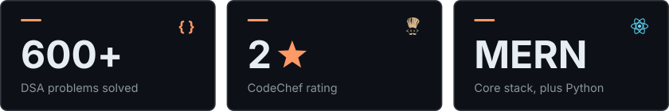
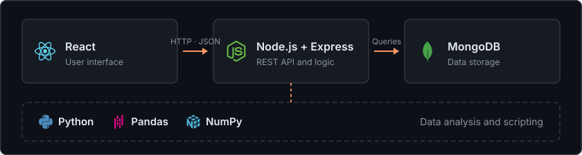

  

 

## About

Full stack developer working with the MERN stack and Python. I build web applications end to end and use Pandas and NumPy for data work. I also practice data structures and algorithms and compete on CodeChef and Codeforces.

## Tech stack

## How I build

## Problem solving

- **600+** data structures and algorithms problems solved
- **CodeChef 2★** · [kushagra_goel0](https://www.codechef.com/users/kushagra_goel0)
- **Codeforces** · [Kushagra_goel](https://codeforces.com/profile/Kushagra_goel)

## Contributions

<picture>
  <source media="(prefers-color-scheme: dark)" srcset="https://raw.githubusercontent.com/Kushagragoel-code/Kushagragoel-code/output/github-snake-dark.svg"/>
  <source media="(prefers-color-scheme: light)" srcset="https://raw.githubusercontent.com/Kushagragoel-code/Kushagragoel-code/output/github-snake.svg"/>
  
</picture>

## Contact

