  

  

  

  

  
  

  

  <picture>
    <source media="(prefers-color-scheme: dark)" srcset="https://raw.githubusercontent.com/Kushagragoel-code/Kushagragoel-code/output/github-snake-dark.svg"/>
    <source media="(prefers-color-scheme: light)" srcset="https://raw.githubusercontent.com/Kushagragoel-code/Kushagragoel-code/output/github-snake.svg"/>
    
  </picture>

  

  
  
  
  

